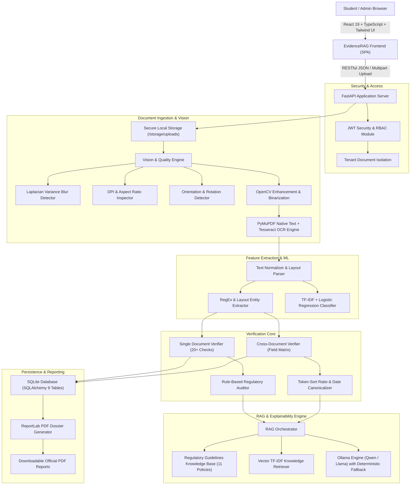
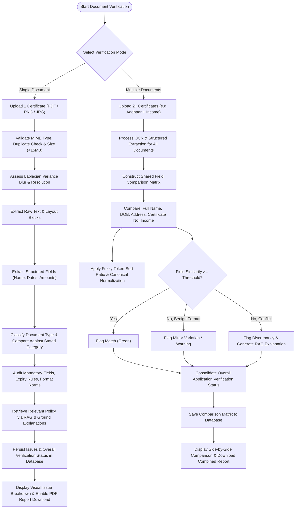
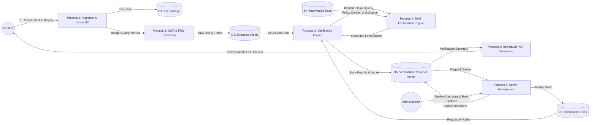
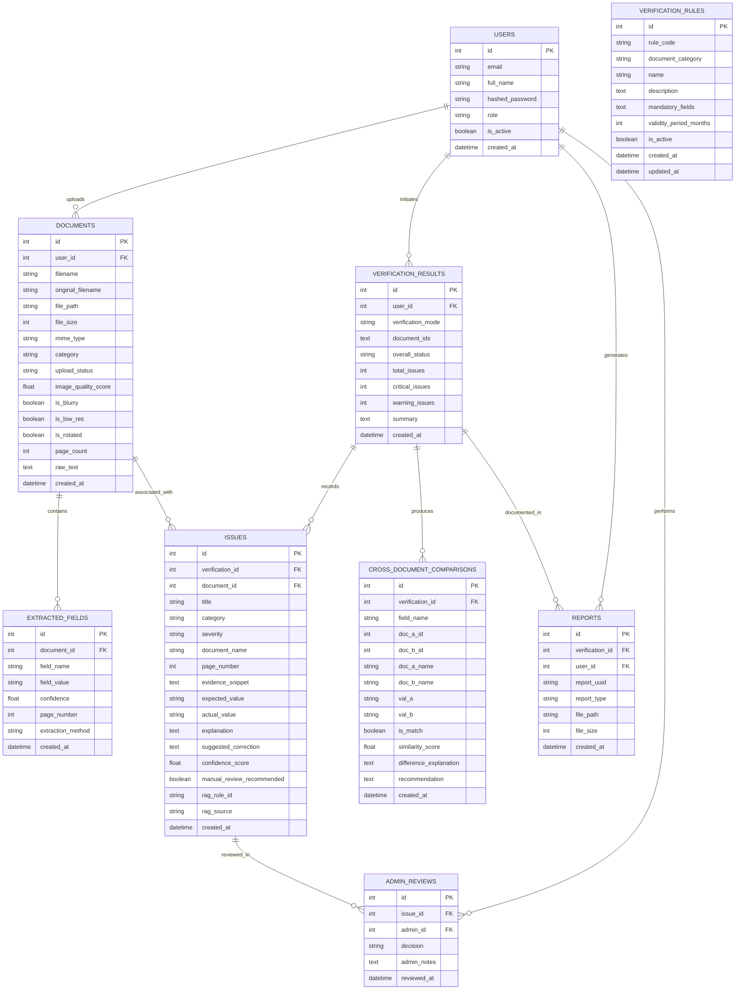
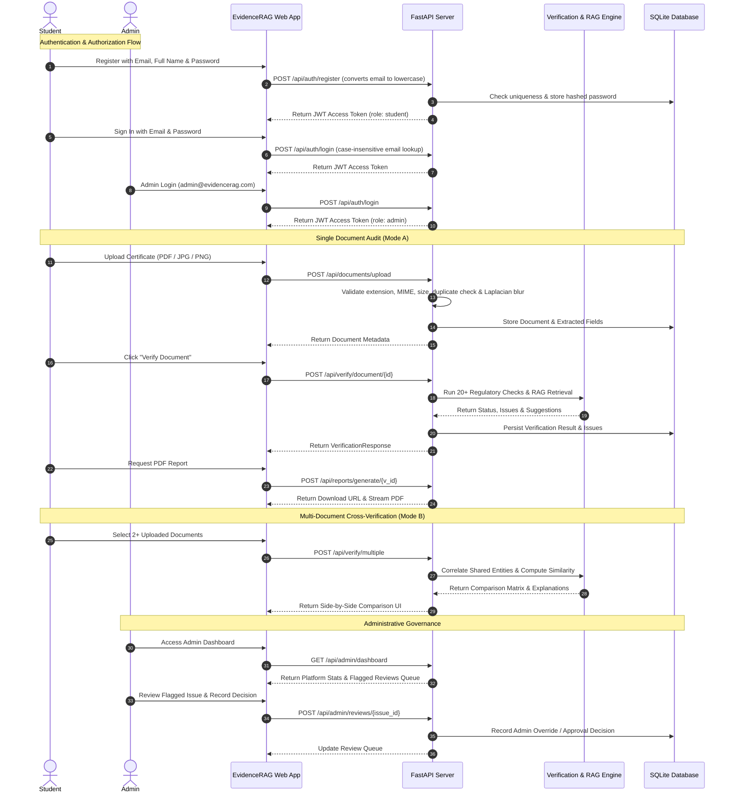

# EvidenceRAG: Explainable Pre-Submission Application Verification Using Retrieval-Augmented Generation

[](https://www.python.org/)
[](https://fastapi.tiangolo.com/)
[](https://react.dev/)
[](https://vitejs.dev/)
[](https://tailwindcss.com/)
[](LICENSE)

An advanced, explainable AI-powered pre-submission verification system for scholarship and higher-education grants. **EvidenceRAG** audits documents uploaded by registered applicants for defects, cross-verifies applicant data across multiple certificates, grounds detected issues in regulatory policy using Retrieval-Augmented Generation (RAG), and produces tamper-resistant, downloadable PDF verification dossiers.

---

## Table of Contents
1. [Abstract](#abstract)
2. [Introduction & Problem Statement](#introduction--problem-statement)
3. [Objectives](#objectives)
4. [Existing vs. Proposed System](#existing-vs-proposed-system)
5. [System Architecture & Visual Diagrams](#system-architecture--visual-diagrams)
   - [System Architecture Diagram](#system-architecture-diagram)
   - [Verification Workflow Diagram](#verification-workflow-diagram)
   - [Data Flow Diagram (DFD Level 1)](#data-flow-diagram-dfd-level-1)
   - [Entity-Relationship (ER) Diagram](#entity-relationship-er-diagram)
   - [Use Case Diagram](#use-case-diagram)
6. [Core Capabilities: Two Verification Modes](#core-capabilities-two-verification-modes)
   - [Mode A: Single Document Verification](#mode-a-single-document-verification)
   - [Mode B: Multiple Document Cross-Verification](#mode-b-multiple-document-cross-verification)
7. [Email Authentication & Role-Based Access Control](#email-authentication--role-based-access-control)
8. [Document Upload & Secure File Management](#document-upload--secure-file-management)
9. [OCR & Vision Quality Pipeline](#ocr--vision-quality-pipeline)
10. [Machine Learning Document Classification](#machine-learning-document-classification)
11. [Retrieval-Augmented Generation (RAG) Architecture](#retrieval-augmented-generation-rag-architecture)
12. [Database Schema](#database-schema)
13. [Step-by-Step Installation & Run Guide](#step-by-step-installation--run-guide)
14. [Automated Verification & Test Suite](#automated-verification--test-suite)
15. [Limitations & Future Enhancements](#limitations--future-enhancements)

---

## Abstract

Government and institutional scholarship portals receive millions of applications each academic cycle. Over 30% of these submissions face procedural rejection or extended review delays due to clerical mistakes: misspelled names across Aadhaar and Income certificates, missing issue dates, blurry scans, cropped certificates, or expired documents. Existing administrative workflows either rely on manual human scrutiny (causing multi-month backlogs) or black-box automated filters that reject applicants without clear explanations.

**EvidenceRAG** solves this critical pre-submission bottleneck. By combining multi-engine Optical Character Recognition (PyMuPDF + PyTesseract), computer vision quality heuristics (Laplacian variance blur quantification, resolution thresholds), supervised ML classification, canonical entity resolution, and a Retrieval-Augmented Generation (RAG) knowledge engine, EvidenceRAG allows students to independently audit their application packet before official submission. For every detected defect, the system provides:
1. Exact evidence snippet and extracted actual value.
2. Expected regulatory benchmark.
3. RAG-grounded explanation citing the relevant government or board guideline.
4. Actionable, step-by-step correction advice.
5. Official downloadable PDF verification reports generated via ReportLab.

The application operates strictly on documents uploaded by registered users, maintaining complete user isolation, zero fake statistics, and an administrative knowledge base kept separate from applicant uploads.

---

## Introduction & Problem Statement

### The Problem
Scholarship applicants, particularly first-generation college students and rural applicants, must assemble numerous certificates from disparate municipal, state, and academic issuing authorities:
- Central Identity (Aadhaar Card)
- Revenue / Income Certificate
- Community / Caste Certificate
- Residence / Domicile Certificate
- Institution Study Certificate
- Bonafide Certificate
- Academic Transcripts / Marks Memo
- Bank Passbook with IFSC

Discrepancies frequently occur:
- **Disparate Spelling:** A student's name may appear as *"P. Rahul"* on an Aadhaar card and *"Rahul Patel"* on a Caste certificate.
- **Expiry Violations:** Income certificates issued more than 12 months prior to application are routinely invalid under revenue norms.
- **Physical Scan Defects:** Camera motion blur, rotated orientation, or cropped certificate seals cause automated OCR rejection at the receiving portal.
- **Missing Vital Fields:** Submitting an income certificate where the revenue amount box is blank or illegible.

### The Impact
Under existing scholarship portals (e.g., NSP, State e-Pass), students only discover these discrepancies after submission—often weeks past correction deadlines, causing complete scholarship forfeiture and financial distress.

---

## Objectives

1. **Pre-Submission Autonomy:** Enable students to audit individual certificates or complete multi-document portfolios before final submission.
2. **Comprehensive Defect Detection (Mode A):** Detect over 20 distinct failure modes including missing mandatory fields, invalid dates, expired certificates, image blur, low DPI, rotation, unreadable text, and category mismatch.
3. **Cross-Document Entity Resolution (Mode B):** Cross-correlate vital entities (Name, Date of Birth, Certificate Numbers, Income, Addresses) across uploaded documents while tolerating benign formatting variations.
4. **Explainable AI via RAG:** Replace unhelpful error codes with explainable legal and administrative justifications grounded in official scholarship guidelines.
5. **Human-in-the-Loop Governance:** Provide an administrative portal with review queues, rule customization, and metric tracking.
6. **Zero Fraud Hallucination:** Enforce a strict ethical constraint: the AI never declares a document "fraudulent" or "fake"; it exclusively flags discrepancy indicators and recommends manual human review.

---

## Existing vs. Proposed System

| Parameter | Existing Scholarship Portals | Proposed EvidenceRAG System |
| :--- | :--- | :--- |
| **Verification Stage** | Post-submission only (delayed rejection) | Pre-submission (proactive student audit) |
| **Error Feedback** | Generic error codes or unexplained rejection | RAG-grounded explanations with policy citations |
| **Cross-Verification** | Fragmented manual scrutiny by state officers | Automated cross-document comparison matrix |
| **Physical Scan Checks** | Blind failure on unreadable scans | Laplacian blur detection & DPI quality metrics |
| **Name Variation Handling** | Exact match failure on initials or honorifics | Token-sort ratio & canonical string normalization |
| **Reports** | No formal verification docket | Downloadable ReportLab PDF dossiers |
| **Applicant Guidance** | None; applicant must guess corrective action | Concrete, step-by-step suggestions per issue |

---

## System Architecture & Visual Diagrams

### System Architecture Diagram



---

### Verification Workflow Diagram



---

### Data Flow Diagram (DFD Level 1)



---

### Entity-Relationship (ER) Diagram



---

### Use Case Diagram



---

## Core Capabilities: Two Verification Modes

### Mode A: Single Document Verification
Enables applicants to test individual documents independently before assembling their complete package. The single verifier executes over 20 discrete automated checks:

1. **Missing Mandatory Fields:** Identifies absence of full name, date of birth, certificate numbers, or category specifics.
2. **Missing Name or Vital Details:** Flags instances where the name field is missing, contains placeholder text (`N/A`, `Unknown`), or is truncated.
3. **Incorrect or Incomplete Text:** Detects incomplete sentences or broken layout blocks.
4. **Spelling Inconsistencies:** Checks for typographical errors and internal name misalignments.
5. **Invalid Date Formats:** Flags non-standard formats, detecting strings that violate ISO or standard Indian regional formats.
6. **Impossible Dates:** Identifies non-existent calendar dates (e.g., February 30th, month > 12, or dates in the future).
7. **Missing Issue Dates:** Verifies presence of a legible issuing timestamp.
8. **Expired Certificates:** Automatically computes document age against configured validity rules (e.g., Income Certificates valid strictly for 12 months).
9. **Invalid Certificate Number Formats:** Validates standard alphanumeric patterns against issuing authority conventions.
10. **Incorrect Numeric Formats:** Inspects annual family income values, ensuring positive currency integers without corrupt symbols.
11. **Unreadable OCR Output:** Flags documents where OCR produces fewer than 25 characters or 5 words.
12. **Poor Image Quality:** Computes overall quality scores based on contrast, blur, and resolution metrics.
13. **Blurry Scans:** Measures image focus using the OpenCV Laplacian operator variance ($\sigma^2 < 95$).
14. **Low Resolution Scans:** Detects images below $650 \times 650$ pixels or PDFs rendered at sub-optimal DPI.
15. **Rotated Documents:** Identifies landscape or inverted scans that impair OCR readability.
16. **Cropped Text / Page Clipping:** Detects text bounding boxes that intersect physical page margins.
17. **Missing or Blank Pages:** Flags multi-page PDFs containing empty pages.
18. **Unexpected Document Structure:** Flags documents deviating significantly from expected administrative layout hierarchies.
19. **Duplicate Uploads:** Detects duplicate files submitted by the same user.
20. **Document Editing Indicators:** Identifies anomalous font variations and digital overlay artifacts.
21. **Missing Signature / Stamp Indicators:** Checks for the presence of official stamp/seal phrases (`Digitally Signed`, `Competent Authority`, `Official Seal`).
22. **Incorrect Document Category:** Compares user-selected category against the machine learning predicted document class.

---

### Mode B: Multiple Document Cross-Verification
Audits the coherence of an entire application package across 2 to 10+ certificates:

- **Entity Correlation:** Constructs a pairwise comparison matrix cross-referencing shared entities:
  - **Full Legal Name**
  - **Date of Birth**
  - **Permanent / Residential Address**
  - **Annual Family Income**
  - **Official Certificate Numbers**
  - **Educational Institution & Course**
  - **Academic Year**
  - **Issue Dates**
- **Tolerance for Benign Variations:** Automatically resolves harmless formatting variations:
  - Honorific variations (`Mr.`, `Ms.`, `Kumari`, `Sri`)
  - Case differences (`UPPERCASE` vs `Title Case`)
  - Whitespace irregularities
  - Middle name initials (`Aarav K. Sharma` vs `Aarav Kumar Sharma`)
- **Fuzzy Token Sort Ratio:** Employs configurable similarity thresholds ($0.85$ default) to differentiate between legitimate matches and substantive conflicts.
- **Explainable Discrepancy Advisories:** Produces side-by-side comparison tables explaining exact differences and recommending corrective action.

---

## Email Authentication & Role-Based Access Control

- **Sign Up (`POST /api/auth/register`):**
  - **Clean 3-Field Interface:** Email address, Account Role dropdown (`Student / Scholarship Applicant`, `Administrator`), and Password with interactive Show/Hide toggle. Full legal name and confirm password are intentionally omitted.
  - **Administrator Authorization Guard:** Selecting "Administrator" requires entering an institution authorization security key (`AdminSecret@2026`) to prevent public users from creating unauthorized administrative accounts. Unauthenticated administrator registrations are rejected with `403 Forbidden`.
  - **Email Normalization:** Converts email to lowercase before storage and enforces case-insensitive uniqueness checks to prevent duplicate accounts.
  - **Password Security:** Enforces minimum 6-character length and hashes with **Bcrypt**. Plain-text passwords are never stored.
- **Sign In (`POST /api/auth/login`):**
  - Authenticates via email and password (not username).
  - Case-insensitive email comparison against registered database records.
  - Rejects unregistered emails and incorrect passwords with secure error messaging.
  - Features interactive **Show / Hide Password** toggle.
  - **Role-Based Redirection:** Authenticated students are redirected automatically to `/dashboard`, while administrators are routed directly to `/admin`.
  - Generates signed **JWT tokens** with configurable expiration.
- **Role-Based Protection:**
  - `student`: Access to personal dashboard, document uploads, single/cross verification, and PDF reports.
  - `admin`: Exclusive access to `/admin` dashboard, flagged review queues, verification rules management, and RAG knowledge base policy testing.

---

## The 22 Complete Application Pages

| # | Page Name | Route | Description |
|---|-----------|-------|-------------|
| 1 | **Landing Page** | `/` | System overview, two verification engine details, RAG pipeline architecture, and CTA. |
| 2 | **Sign Up Page** | `/register` | 3-field registration: Email, Role dropdown, Password with toggle, and Admin auth key guard. |
| 3 | **Sign In Page** | `/login` | Email and password login with Show/Hide toggle, case-insensitive auth, and role redirect. |
| 4 | **Student Dashboard** | `/dashboard` | Metrics, status charts (Recharts), zero-state notices, and quick verification launchers. |
| 5 | **Document Upload Page** | `/upload` | Drag-and-drop ingestion for PDF/PNG/JPG, category selector, and OCR extraction. |
| 6 | **Single Document Verification** | `/verify/single` | Mode A: 20+ checks, missing fields, blur detection, RAG policy citations, PDF download. |
| 7 | **Multi-Document Cross-Verification** | `/verify/cross` | Mode B: Entity comparison matrix, name/DOB/address conflict analysis, combined PDF. |
| 8 | **Document Details Page** | `/documents/:id` | Document preview, OCR extracted fields grid, blur variance score, and detected defects. |
| 9 | **Evidence Highlighting Viewer** | `/evidence/:issueId` | Document preview with bounding box highlight overlays and regulatory policy citations. |
| 10 | **Smart Document Comparison** | `/compare` | Side-by-side certificate inspection and field discrepancy matrix for conflicting documents. |
| 11 | **Readiness Score Page** | `/readiness` | Transparent 0-100 submission readiness score meter, weighted breakdown, and deduction list. |
| 12 | **Scholarship Application Checklist** | `/checklist` | Scheme selector, requirement progress bar, and required certificate fulfillment tracker. |
| 13 | **Ask Your Document AI Assistant** | `/assistant` | Interactive evidence-grounded chat assistant with document citations and deterministic fallback. |
| 14 | **Verification History Page** | `/history` | Chronological audit trail of all single and cross-document verification batches. |
| 15 | **Document Version History** | `/documents/:id/versions` | Document revision timeline, change summaries, and corrected scan re-submission flow. |
| 16 | **Reports Page** | `/reports` | Repository of generated ReportLab PDF dossiers with direct download links. |
| 17 | **Student Profile Page** | `/profile` | Account details, registered email, system role, and secure sign-out. |
| 18 | **Admin Dashboard** | `/admin` | System-wide statistics, audit distribution charts, review queues, and activity monitor. |
| 19 | **Admin Review Page** | `/admin/reviews` | Flagged issue review queue with Approve / Reject / Override Pass decision recording. |
| 20 | **Admin Audit Trail Page** | `/admin/audit-logs` | Chronological administrative audit logs of issue reviews, rule edits, and uploads. |
| 21 | **Verification Rules Management** | `/admin/rules` | Manage active verification rules, mandatory field lists, and validity periods (months). |
| 22 | **Reference Knowledge Base** | `/admin/knowledge-base` | Administrative RAG knowledge base of 11 statutory norms with live semantic query testing. |

---

## Document Upload & Secure File Management

- **Supported File Types:** PDF, JPG, JPEG, PNG.
- **Upload Endpoint (`POST /api/documents/upload`):**
  - Validates file extensions and MIME types.
  - Enforces a 15MB file size limit.
  - Rejects empty (0-byte) files.
  - Rejects duplicate uploads by the same user.
  - Stores files with unique UUID filenames to prevent path traversal attacks.
- **User Document Isolation:** Every document is strictly bound to `current_user.id`. One student cannot access, preview, or delete another student's documents.

---

## OCR & Vision Quality Pipeline

1. **Direct PyMuPDF Text Extraction:** Reads text directly from digital PDF pages with layout coordinates.
2. **OpenCV Image Preprocessing:**
   - Grayscale conversion
   - Noise removal via median filtering (`cv2.medianBlur`)
   - Contrast enhancement with CLAHE (`cv2.createCLAHE`)
   - Deskewing and rotation angle correction via minimum area bounding rectangle
   - Adaptive thresholding for crisp character segmentation
3. **Tesseract OCR Integration:** Invoked for scanned pages or images when system Tesseract is installed; graceful fallback occurs when running in environments without native Tesseract.
4. **Laplacian Blur Quantification:** Focus variance $\sigma^2 = \text{Var}(\nabla^2 I)$. Scans with $\sigma^2 < 95.0$ are flagged as blurry.

---

## Machine Learning Document Classification

- **Supervised Pipeline:** TF-IDF feature extraction (unigram + bigram, sublinear scaling) paired with Multinomial Logistic Regression (`solver="lbfgs"`, balanced class weights).
- **Model Persistence:** Stored in `models/document_classifier.joblib`.
- **Heuristic Fallback:** When a trained model is not present, the classifier employs rule-based keyword matching across all 10 document categories.
- **Training on Custom Labeled Data:**
  To train the classifier on a user-provided labeled dataset:
  ```powershell
  python scripts/train_classifier.py --dataset-json /path/to/labels.json --docs-dir /path/to/documents
  ```

---

## Retrieval-Augmented Generation (RAG) Architecture

The RAG engine ensures that verification feedback is legally and administratively grounded in official scholarship guidelines rather than heuristic error codes.

```
Detected Defect -> Vector Query -> TF-IDF Cosine Retrieval -> Knowledge Base (11 Policies) -> Prompt Formulation -> Ollama LLM / Grounded Fallback -> Structured Advisory
```

### Knowledge Base Rules Catalog
1. `RULE-AADHAAR-01`: Unique Identification Authority of India (UIDAI) Demographic Verification Guidelines.
2. `RULE-INCOME-01`: State Revenue Department Income Certificate Validity Norms (12-Month Hard Expiry).
3. `RULE-CASTE-01`: Ministry of Social Justice & Empowerment Community Certificate Protocol.
4. `RULE-RESIDENCE-01`: Domicile & Permanent Residence 36-Month Verification Standards.
5. `RULE-STUDY-01`: State Higher Education Department Study Certificate Guidelines.
6. `RULE-BONAFIDE-01`: Institutional Bonafide Enrollment Protocol.
7. `RULE-MARKS-01`: State Board of Technical & Higher Education Academic Transcript Rules.
8. `RULE-BANK-01`: Public Financial Management System (PFMS) Direct Benefit Transfer Bank Passbook Guidelines.
9. `RULE-PHOTO-01`: Standard National Scholarship Portal Photograph Specifications.
10. `RULE-GENERAL-CROSS`: Pre-Submission Scholarship Cross-Document Identity Concordance Rules.
11. `RULE-SCAN-QUALITY`: Ministry of Electronics & Information Technology Document Digitization Standards.

### Ollama LLM Integration & Graceful Fallback
- **Active LLM Mode:** Connects to a locally running Ollama instance (e.g., `qwen2.5:7b`, `llama3.2:3b`) when available.
- **Deterministic Policy Fallback:** When Ollama is offline or not installed, the engine synthesizes an evidence-grounded explanation directly from the retrieved knowledge rule, guaranteeing 100% offline functionality.

---

## Database Schema

Implemented in SQLite via SQLAlchemy ORM with foreign keys and cascade deletions:

1. **`users`**: User identities, role (`student`, `admin`), hashed passwords.
2. **`documents`**: Document metadata, file paths, upload status, visual quality scores, page count, raw OCR text.
3. **`extracted_fields`**: Key-value pairs extracted from documents, confidence scores, extraction methods.
4. **`verification_results`**: Audit records, overall status (`Passed`, `Passed with Warnings`, `Needs Correction`, `Manual Review Required`), issue counts, executive summaries.
5. **`issues`**: Discrete defects linked to verifications, severity (`critical`, `high`, `medium`, `low`), evidence snippets, actual vs expected values, RAG citations, and suggestions.
6. **`cross_document_comparisons`**: Pairwise field comparisons across documents, similarity scores, match booleans, discrepancy explanations.
7. **`verification_rules`**: Configurable regulatory policies, mandatory field lists, validity periods in months, active statuses.
8. **`admin_reviews`**: Audit records of human-in-the-loop decisions (`approved`, `rejected`, `override_pass`, `requires_resubmission`) with administrator notes.
9. **`reports`**: PDF dossier records, UUIDs, disk file paths, generation timestamps.

---

## Step-by-Step Installation & Run Guide

### Prerequisites
- **Python 3.11, 3.12, or 3.13**
- **Node.js 18+ & npm**
- **Git**
- *(Optional)* [Tesseract OCR](https://github.com/UB-Mannheim/tesseract/wiki) for scanned image OCR.
- *(Optional)* [Ollama](https://ollama.ai/) for local LLM inference (`ollama run qwen2.5:7b`).

---

### Step 1: Environment Setup
1. **Clone Repository & Enter Workspace:**
   ```powershell
   cd "c:\Users\Harsh\Documents\Downloads\evidence rag"
   ```

2. **Install Backend Dependencies:**
   ```powershell
   pip install -r backend/requirements.txt
   ```

3. **Initialize Database Tables & Verification Rules:**
   ```powershell
   python -c "from backend.app.database.init_db import init_database; init_database()"
   ```

4. **Seed Development Admin User:**
   ```powershell
   python scripts/seed_admin.py --email admin@evidencerag.com --password Admin@12345 --name "System Administrator"
   ```

---

### Step 2: Build Frontend Bundle
```powershell
cd frontend
npm install
npm run build
cd ..
```
*(The production build is placed into `frontend/dist` and served directly by FastAPI).*

---

### Step 3: Run the Application

#### Option A: Unified Single-Server Mode (Recommended)
FastAPI serves the complete REST API (`/api/*`), interactive Swagger docs (`/docs`), and the React web application (`/`):

```powershell
python -m uvicorn backend.app.main:app --host 127.0.0.1 --port 8000
```
- Open in your browser: **[http://127.0.0.1:8000](http://127.0.0.1:8000)**
- Interactive API Documentation: **[http://127.0.0.1:8000/docs](http://127.0.0.1:8000/docs)**

#### Option B: Dual-Server Development Mode
- **Backend API (Terminal 1):**
  ```powershell
  python -m uvicorn backend.app.main:app --host 127.0.0.1 --port 8000 --reload
  ```
- **Vite React Dev Server (Terminal 2):**
  ```powershell
  cd frontend
  npm run dev
  ```
  Open **[http://localhost:5173](http://localhost:5173)** in your browser.

---

## Automated Verification & Test Suite

EvidenceRAG includes automated tests in `backend/tests/test_end_to_end.py` and `backend/tests/test_health.py`. All tests use isolated temporary test fixtures generated dynamically at runtime:

1. `test_01_system_health`: Verifies API liveness and version.
2. `test_02_email_registration_and_duplicate_prevention`: Verifies email normalization, case conversion, and duplicate registration rejection.
3. `test_03_login_validation_and_case_insensitivity`: Tests case-insensitive email sign-in, wrong password rejection, and unregistered user rejection.
4. `test_04_role_based_access_control`: Verifies student access restriction on admin endpoints.
5. `test_05_document_upload_and_validation`: Tests file extension validation, empty file rejection, valid upload, and duplicate upload prevention.
6. `test_06_user_document_isolation`: Confirms User B cannot view or delete User A's uploaded documents.
7. `test_07_single_verify_valid_document`: Tests Mode A verification on a compliant certificate.
8. `test_08_single_verify_missing_fields_detection`: Tests Mode A detection of missing mandatory fields and issue explanation.
9. `test_09_single_verify_blurry_scan_detection`: Tests Laplacian blur quantification on blurry scans.
10. `test_10_cross_verification_matching_documents`: Tests Mode B entity matching across 2 certificates.
11. `test_11_cross_verification_mismatch_detection`: Tests Mode B detection of conflicting names with difference explanation.
12. `test_12_cross_verification_more_than_two_documents`: Tests Mode B cross-verification across 3+ certificates.
13. `test_13_rag_retrieval_and_explanation`: Verifies RAG vector rule lookup and grounded explanation synthesis.
14. `test_14_pdf_report_generation_and_download`: Tests ReportLab PDF report generation and validates binary `%PDF` header.
15. `test_15_admin_review_and_rule_management`: Tests admin issue review recording and verification rule threshold updating.
16. `test_16_admin_knowledge_base_management_and_rag_test_query`: Verifies RAG knowledge base rule retrieval, live semantic query testing, custom rule addition, modification, and deletion.
17. `test_17_evidence_highlighting`: Tests issue page references, bounding box calculations, and evidence highlighting viewer payload.
18. `test_18_readiness_scoring`: Tests application-wide aggregate readiness score calculation and single-document readiness deduction audits.
19. `test_19_assistant_chat`: Tests evidence-grounded AI conversational assistant chat response synthesis, citations, and conversation history.
20. `test_20_checklist_and_schemes`: Tests scholarship scheme checklist evaluation, progress percentage, and requirement completion status.
21. `test_21_document_versioning`: Tests document version history, archive creation, and corrected certificate re-submission flow.
22. `test_22_correction_checklist_pdf`: Tests ReportLab pre-submission correction checklist PDF generation and binary validation.
23. `test_23_admin_audit_logs`: Tests administrative audit trail logging and RBAC security enforcement.
24. `test_root`: Tests API welcome root endpoint.
25. `test_health`: Tests system health status and component checks.

### Run All Tests
```powershell
python -m pytest backend/tests/test_end_to_end.py backend/tests/test_health.py -v
```

**Measured Test Result:**
```
====================== 25 passed in 1:42 ======================
```

---

## Limitations & Future Enhancements

### Limitations
1. **Physical Tesseract Binary on Windows:** When running without the native Tesseract binary on Windows PATH, image OCR relies on PyMuPDF text layers; scanned images require Tesseract or EasyOCR installed on the host.
2. **Language Coverage:** Current rule definitions and entity extraction regex patterns target English-language certificates and common pan-Indian state transliterations; regional language scripts (e.g., Telugu, Hindi, Tamil) require additional OCR language packs.
3. **Complex Tables in Marks Memos:** Non-standard semester tabular layouts may require custom vision-language models (e.g., Donut or LayoutLMv3) for exact subject-wise grade extraction.

### Future Enhancements
1. **Direct DigiLocker API Integration:** Enable direct credential-based certificate import from DigiLocker / NAD (National Academic Depository).
2. **On-Device Multimodal Small Language Models:** Integrate quantized on-device SLMs (e.g., SmolVLM, Moondream) for direct visual question answering over complex seals and stamps.
3. **Real-time Mobile Camera Capture:** Provide progressive web app (PWA) camera guidance with real-time blur and edge-detection overlays to guide applicants during photo taking.
4. **Multilingual Regional Support:** Expand RAG knowledge rules and explanations into 12 recognized Indian languages.

---

## Project Structure Overview

```
evidence rag/
├── backend/
│   ├── app/
│   │   ├── api/
│   │   │   ├── endpoints/
│   │   │   │   ├── admin.py
│   │   │   │   ├── assistant.py
│   │   │   │   ├── auth.py
│   │   │   │   ├── checklist.py
│   │   │   │   ├── documents.py
│   │   │   │   ├── evidence.py
│   │   │   │   ├── readiness.py
│   │   │   │   ├── reports.py
│   │   │   │   └── verification.py
│   │   │   └── router.py
│   │   ├── core/
│   │   │   ├── config.py
│   │   │   ├── dependencies.py
│   │   │   └── security.py
│   │   ├── database/
│   │   │   ├── init_db.py
│   │   │   └── session.py
│   │   ├── models/
│   │   │   └── entities.py
│   │   ├── schemas/
│   │   │   ├── auth.py
│   │   │   ├── document.py
│   │   │   └── verification.py
│   │   ├── services/
│   │   │   ├── ml/
│   │   │   │   └── classifier.py
│   │   │   ├── ocr/
│   │   │   │   ├── extractor.py
│   │   │   │   ├── processor.py
│   │   │   │   └── quality.py
│   │   │   ├── rag/
│   │   │   │   ├── engine.py
│   │   │   │   └── knowledge_base.py
│   │   │   ├── reports/
│   │   │   │   └── generator.py
│   │   │   └── verification/
│   │   │       ├── cross_verifier.py
│   │   │       └── single_verifier.py
│   │   └── main.py
│   ├── requirements.txt
│   └── tests/
│       ├── test_end_to_end.py
│       └── test_health.py
├── frontend/
│   ├── dist/ (Production build served by FastAPI)
│   ├── src/
│   │   ├── api/
│   │   │   └── client.ts
│   │   ├── components/
│   │   │   ├── Navbar.tsx
│   │   │   ├── RAGExplanationCard.tsx
│   │   │   ├── Sidebar.tsx
│   │   │   └── StatusBadge.tsx
│   │   ├── context/
│   │   │   └── AuthContext.tsx
│   │   ├── pages/
│   │   │   ├── admin/
│   │   │   │   ├── AdminAuditPage.tsx
│   │   │   │   ├── AdminDashboard.tsx
│   │   │   │   ├── AdminKnowledgePage.tsx
│   │   │   │   ├── AdminReviewPage.tsx
│   │   │   │   ├── AdminRulesPage.tsx
│   │   │   │   └── AdminUsersPage.tsx
│   │   │   ├── AssistantPage.tsx
│   │   │   ├── ChecklistPage.tsx
│   │   │   ├── DocumentDetailsPage.tsx
│   │   │   ├── DocumentUploadPage.tsx
│   │   │   ├── EvidenceViewerPage.tsx
│   │   │   ├── HistoryPage.tsx
│   │   │   ├── LandingPage.tsx
│   │   │   ├── LoginPage.tsx
│   │   │   ├── MultiVerifyPage.tsx
│   │   │   ├── ProfilePage.tsx
│   │   │   ├── ReadinessPage.tsx
│   │   │   ├── RegisterPage.tsx
│   │   │   ├── ReportsPage.tsx
│   │   │   ├── SingleVerifyPage.tsx
│   │   │   ├── SmartComparePage.tsx
│   │   │   ├── StudentDashboard.tsx
│   │   │   └── VersionHistoryPage.tsx
│   │   ├── App.tsx
│   │   └── main.tsx
│   ├── index.html
│   ├── package.json
│   └── vite.config.ts
├── models/
│   ├── document_classifier.joblib
│   └── evaluation_metrics.json
├── scripts/
│   ├── migrate_db.py
│   ├── seed_admin.py
│   ├── sync_db_schema.py
│   └── train_classifier.py
├── storage/
│   ├── evidencerag.db (SQLite database with 16 tables)
│   ├── reports/ (Generated ReportLab PDF dossiers)
│   └── uploads/ (User uploaded certificates)
├── DEVELOPMENT_CHECKLIST.md
└── README.md
